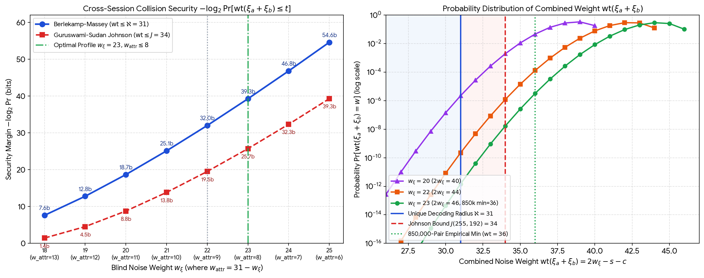

# A-Scheme: Information-Theoretic Covert Transport

[](https://doi.org/10.5281/zenodo.23578925)
[](https://opensource.org/licenses/MIT)

[](http://magma.maths.usyd.edu.au/)
[]()

This repository contains the proof-of-concept (PoC) implementation, benchmarking suite, and interactive simulators for the A-Scheme framework, which provides homomorphic XOR emulation and attribute-driven access control.

## Repository Contents

- **`a-scheme-base3-demo.html`**: An interactive web simulator demonstrating the Base-3 Packing technique and homomorphic XOR emulation over the GF(256) field. The simulator visualizes the EC-ElGamal cryptographic layer, blind server-side addition, and client-side scalar extraction with subsequent bitwise reconstruction.
- **`SaaC_prototyping.m`**: The master Magma script implementing the full protocol lifecycle: from Bootstrap and key derivation to secure session establishment and ratcheting (Reinitialization). The script utilizes RFC 5869 HKDF for all chain operations, Elligator Squared for elliptic curve point obfuscation, and a 2-Bit Parity Filter for steganographic metadata concealment.
- **`benchmark.m`**: A script for comprehensive end-to-end benchmarking of the baseline A-Scheme. It integrates a standard Reed-Solomon [255, 128, 128]₂₅₆ algebraic engine over GF(256) (code rate *R* ≈ 0.50), Curve25519 cryptographic primitives, and homomorphic XOR emulation featuring O(1) table-based ECDLP resolution.
- **`rs256_192_65.m`**: An upgraded end-to-end Magma benchmark script implementing the high-rate extended non-systematic Reed-Solomon [256, 192, 65]₂₅₆ algebraic engine over GF(256) (code rate *R* = 0.75). It incorporates a random invertible scrambling matrix *S* ∈ GL(192, GF(256)) for MDS puncturing defense, 256-byte Curve25519 homomorphic XOR evaluation, punctured syndrome decoding (clearing ℵ = 31 symbol errors), and linear payload recovery via submatrix inversion.
- **`monolithic-ascheme-scenarios.m`**: An end-to-end protocol and cryptanalytic attack verification suite over Curve25519. It validates the monolithic KEM payload encapsulation (session keys, integrity hashes, broadcast rosters, and compact Schnorr signatures) along with self-unmasking ephemeral half-radius blind noise (wt(<b>ξ</b><sub><i>i</i></sub>) = 23, <i>w</i><sub>attr</sub> ≤ 8) generated via deterministic `Expand_PRG` expansion. It simulates 7 distinct operational and adversarial scenarios—including an 850,000-pair Monte Carlo simulation—demonstrating complete resilience against cross-session linear addition attacks, tag annihilation failures, and full session compromise.
- **`optimized_Gaudry-Schost.m`**: A memory-optimized Magma implementation of the Gaudry-Schost algorithm for resolving the short-interval ECDLP on Montgomery Curve25519 without relying on precomputed lookup tables. The algorithm leverages equivalence classes (coordinates with opposite signs) and an asymmetric compression ratio of 0.1 to accelerate the collision search.

## Security Highlights: Ephemeral Blind Noise & Cross-Session Defense

To prevent advanced inter-frame and cross-session linear addition attacks (<b>c</b>'<sub>1</sub> + <b>c</b>'<sub>2</sub>) by an honest-but-curious server, the A-Scheme integrates stream-seeded ephemeral half-radius blind noise (<b>ξ</b><sub><i>i</i></sub> with weight <i>w</i><sub>ξ</sub> = 23, paired with attribute discrepancy budget <i>w</i><sub>attr</sub> ≤ 8 at mutation radius <i>r</i><sub>mut</sub> = 4):

- **Intra-Epoch and Inter-Session Protection:** While static Access Codes allow mask annihilation under pairwise combinations (<i>T</i> = 2), injecting per-session ephemeral blind noise ensures that any attempted linear addition combines independent support weights (wt(<b>ξ</b><sub><i>a</i></sub> + <b>ξ</b><sub><i>b</i></sub>) = 2<i>w</i><sub>ξ</sub> − <i>s</i> − <i>c</i>), yielding a total error weight strictly exceeding both the unique Reed–Solomon decoding threshold (ℵ = 31) and the full-code Guruswami–Sudan Johnson bound (<i>J</i>(255, 192) = 34), with unique-decoding collision probabilities bounded below 1.50 × 10<sup>−12</sup> ≈ 2<sup>−39.3</sup> (and 2.30 × 10<sup>−10</sup> ≈ 2<sup>−32.0</sup> at <i>w</i><sub>ξ</sub> = 22).
- **Cross-Session Key Isolation:** By binding the ephemeral noise generation to the session key and cryptographic salt (<b>ξ</b><sub><i>i</i></sub> = Expand<sub>PRG</sub>(<b>κ̂</b><sub><i>i</i></sub> || <i>σ</i><sub><i>i</i></sub>)) or localizing <b>ξ</b><sub><i>i</i></sub> via CSPRNG in the left-hand blocker coordinates, the server is prevented from decoding the linear payload sum <i>κ</i><sub>1</sub> ⊕ <i>κ</i><sub>2</sub>, preserving full inter-session key isolation even if a historical session key is compromised.

## An Interactive Web Simulator

### Overview
This supplementary material provides an interactive, standalone simulation of the **Base-3 Packing** technique and the homomorphic evaluation process.

The simulator allows users to visually and mathematically explore how bitwise XOR operations are emulated within additively homomorphic scalar rings without carry-over, and how the underlying EC-ElGamal randomizers are algebraically annihilated during decryption.

### Technical Note: The Byte-to-Scalar Pipeline
This interactive widget simulates the exact processing of a single attribute (an 8-bit byte) from the access vectors over GF(256). The homomorphic XOR emulation transitions smoothly between three mathematical domains:

1. **Deconstruction (Finite Field):** An individual attribute from the access vector is strictly mapped to an 8-bit binary representation (*x*, *y* ∈ {0, 1}⁸).
2. **Base-3 Packing (Scalar Ring):** These 8 bits are weighted and packed into a single carry-free scalar value (*η* = 8, maximum scalar sum = 6560).
3. **Cryptographic Layer (Elliptic Curve):** The server homomorphically adds these packed scalars across ciphertexts using standard EC point addition. The simulation details the EC-ElGamal layer, illustrating how random ephemeral scalars mask the points and how these masks are subsequently annihilated by the receiver's private key.
4. **Unpacking (Arithmetic):** The receiver resolves the short-interval ECDLP via the Gaudry-Schost algorithm to recover the sum, then iteratively extracts the exact XORed bits via modulo-3 and modulo-2 arithmetic.
5. **Reassembly (Finite Field):** The reconstructed bits are assembled back into the exact bitwise XOR difference (denoted as *e* ∈ GF(256)), successfully demonstrating a carry-free XOR operation over the original inputs.

### System Requirements
- **Dependencies:** None. The demonstration relies entirely on standard vanilla HTML, CSS, and JavaScript.
- **Network:** No internet connection is required to run the simulation after downloading.
- **Compatibility:** Works on any modern web browser (Google Chrome, Mozilla Firefox, Apple Safari, Microsoft Edge, etc.).

### How to Run the Demonstration
1. Download the `a-scheme-base3-demo.html` file to your local machine.
2. Double-click the downloaded `.html` file. It will automatically open in your default web browser.
3. Use the interactive buttons to toggle the individual bits of the Sender's and Receiver's attributes.
4. Click the **"Evaluate Homomorphic Crypto Pipeline ↓"** button to step through the Server-Side blind addition, the Client-Side mask annihilation, and the Base-3 extraction math.
5. Click the **"↻ Generate New Random Attributes & Restart"** button at the bottom to quickly test the mathematical consistency against different random bit combinations.

### Security & Privacy Note
This is a purely client-side simulation. No data is transmitted, and no external libraries or APIs are called.

## Empirical Verification & Cryptanalytic Benchmark (`monolithic-ascheme-scenarios.m`)

The complete protocol pipeline and cryptanalytic defense suite—including an **850,000-pair Monte Carlo simulation** at $w_\xi = 23, w_{\mathrm{attr}} = 8$—execute directly in the **Magma Online Calculator** (`http://magma.maths.usyd.edu.au/calc/`) in **59.710 seconds** (within the 60-second sandbox limit). Across all $850{,}000$ trials, the empirical mean support overlap converges to **2.075** (matching the theoretical expectation $\mathbb{E}[s] = 23^2/255 \approx 2.075$ to three decimal places), and the minimum observed combined noise weight is **36**, remaining strictly above both the unique Berlekamp–Massey decoding radius ($\aleph = 31$) and the full-code Guruswami–Sudan Johnson bound ($J(255, 192) = 34$).

### Console Output (`Magma V2.29`)

```text
=== MONOLITHIC A-SCHEME SETUP ON CURVE25519 (Online Calculator) ===
Generating O(1) ECDLP LUT on Curve25519 for Max Z = 13120...
Domain & Non-Systematic RS Setup completed in 0.200 sec.

=== PART 4: FAST HOMOMORPHIC CHANNEL & DECODER BENCHMARK ([255, 192, 64]_256) ===
[!] Executing Per-Byte Homomorphic EC-ElGamal XOR (256 blocks)...
Homomorphic Pipeline Time (256 independent ElGamal blocks): 2.090 sec.
RS Status: SUCCESS=true (Cleared 31 / 31 errors) | Payload Match: true | Avg Decode: 2802047 CPU Cycles

==========================================================================
PART 5: MONOLITHIC A-SCHEME PROTOCOL & CRYPTANALYTIC ATTACK SCENARIOS
==========================================================================
Provisioned Cohort Users U_1, U_2, U_3 | wt(r_1) = 64 (> 31) | d_H(r_1, r_2) = 8 (<= w_attr = 8)

=== SCENARIO 1: END-TO-END A-SCHEME (Expand_PRG NOISE + ATTRIBUTE RECOVERY & SCHNORR VERIFY) ===
  [Receiver U_2] Blind RS Decode: true | Combined wt(e_attr + xi_1) = 31 (<= aleph = 31)
  [Receiver U_2] Regenerated xi'_1 == xi_1: true | Sender Attributes r'_1 == r_1: true
  [Receiver U_2] Hash Integrity: true | Dealer Schnorr Signature Valid: true | Session Key Match: true

=== SCENARIO 2A: CROSS-SESSION KEY-SUM EXPOSURE WITHOUT BLIND NOISE (xi = 0) ===
  [Without xi_i] Server RS Decode on (c'_1 + c'_2): true (wt = 0)
  [Without xi_i] Linear Payload Sum (kappa_1 + kappa_2) Exposed:    true
  [Without xi_i] Session Key khat_2 Leaked if Historical kappa_1 Compromised: true

=== SCENARIO 2B: SAME-SENDER CROSS-SESSION ADDITION DEFEATED BY xi_i (wt(xi) = 23) ===
  [With xi_i] Support Overlap |supp(xi_1) cap supp(xi_2)| = 1
  [With xi_i] Combined Blind Noise Weight wt(xi_1 + xi_2) = 45 (> aleph = 31)
  [With xi_i] Server RS Decode on (c'_1 + c'_2): false -> CROSS-SESSION ADDITION BLOCKED!

=== SCENARIO 3: DISTINCT-SENDER ADDITION ATTACK (c'_U1 + c'_U2 IN SAME COHORT) ===
  Attribute Distance wt(r_1 + r_2) = 8 (<= 8), but Total Error wt(r_1 + r_2 + xi_1 + xi_3) = 52 (> 31)
  Server RS Decode on (c'_U1 + c'_U2): false -> ATTRIBUTE DIFFERENCE & KEY EXTRACTION BLOCKED!

=== SCENARIO 4: HOMOMORPHIC ODD COALITION (T = 3) BASE-3 CARRY AVALANCHE ===
  Total 255B RS Core Error Weight (Base-3 Carry Avalanche): 252 / 255 | RS Decode: false

=== SCENARIO 5: EVEN COALITION (T = 2) MASK ANNIHILATION FAILURE ===
  Total 255B RS Core Error Weight (Uncanceled w, m): 251 / 255 | RS Decode: false

=== SCENARIO 6: LEFT-HALF LOCALIZED CSPRNG NOISE (RESILIENCE UNDER FULL kappa_1 LEAK TO SERVER) ===
  [Legitimate U_2] Blind Decode: true (wt = 31) | Direct Right-Half Attribute Recovery (r'_1 == r_1): true
  [Server + Leaked kappa_1] Residual Error on Session 2: wt(xi_loc_2 - xi_loc_1) = 43 (> 31) | Decode: false -> BLOCKED!

=== SCENARIO 7: ANALYTICAL & 850000-PAIR MONTE CARLO SUPPORT OVERLAP BOUND ===
  [Profile wt(xi)=20, w_attr<=11] Exact Pr[s >= 9]  = 1.635924364E-6 | Total Pr[wt <= 31] = 2.382234622E-6 (~ 2^-18.7)
  [Profile wt(xi)=22, w_attr<=9]  Exact Pr[s >= 13] = 7.912538399E-11 | Total Pr[wt <= 31] = 2.298592658E-10 (~ 2^-32.0)
  [Profile wt(xi)=23, w_attr<=8]  Exact Pr[s >= 15] = 2.950130609E-13 | Total Pr[wt <= 31] = 1.504660580E-12 (~ 2^-39.3)
  Theoretical E[s] = 2.075 | Empirical Mean Overlap (850000 pairs) = 2.075
  Empirical Minimum wt(xi_a + xi_b) across 850000 pairs: 36 (Threshold aleph = 31, Johnson J = 34) | Collisions: 0

=== ALL PROTOCOL STAGES & ATTACK SCENARIOS COMPLETED IN 59.710 SEC ===
```

### Verification Summary Table

| Scenario | Operational / Adversarial Test Case | Observed Weight `wt(e)` | Bound (`ℵ = 31`, `J = 34`) | RS Decode | Security Verdict |
| :--- | :--- | :---: | :---: | :---: | :--- |
| **Sc. 1** | End-to-End Monolithic KEM + `Expand_PRG` Stripping & Schnorr Verify | `31` (`8 + 23`) | `<= 31` | `true` | ✅ Validated (<b>r</b>'<sub>1</sub> = <b>r</b><sub>1</sub>) |
| **Sc. 2A** | Cross-Session Addition without Blind Noise (<b>ξ</b><sub><i>i</i></sub> = <b>0</b> Baseline) | `0` | `<= 31` | `true` | ⚠️ <i>κ</i><sub>1</sub> + <i>κ</i><sub>2</sub> Exposed |
| **Sc. 2B** | Same-Sender Cross-Session Addition (<b>c</b>'<sub>1</sub> + <b>c</b>'<sub>2</sub>) with wt(<b>ξ</b><sub><i>i</i></sub>) = 23 | `45` (`overlap = 1`) | `> 34 > 31` | `false` | 🛡️ Addition Blocked |
| **Sc. 3** | Distinct-Sender Cohort Addition (`c'_U1 + c'_U2`, `d_H(r_1, r_2) = 8`) | `52` | `> 34 > 31` | `false` | 🛡️ Attribute Diff Blocked |
| **Sc. 4** | Homomorphic Odd Coalition (`T = 3`, 4 Operands in `G`) | `252 / 255` | `> 34 > 31` | `false` | 🛡️ Base-3 Carry Avalanche |
| **Sc. 5** | Homomorphic Even Coalition (`T = 2`, `M_U2 + M_U3` Self-Annihilation) | `251 / 255` | `> 34 > 31` | `false` | 🛡️ Masks `(w, m)` Intact |
| **Sc. 6** | Left-Half Localized CSPRNG Noise under Full <i>κ</i><sub>1</sub> Leak to Server | `31` (U2) / `43` (Srv) | `<= 31` / `> 34` | `true` / `false` | 🛡️ Session 2 Protected |
| **Sc. 7** | Analytical Hypergeometric Bound & `850,000`-Pair Monte Carlo (`w_xi = 23`) | `min = 36` (`E[s] = 2.075`) | `> 34 > 31` | `0 collisions` | ✅ `Pr ≈ 1.50e-12 (~2^-39.3)` |

### Analytical & Empirical Distribution of Combined Blind Noise (wt(<b>ξ</b><sub><i>a</i></sub> + <b>ξ</b><sub><i>b</i></sub>))



When an adversary or honest-but-curious Server sums two perturbed frames <b>c</b>'<sub><i>a</i></sub> + <b>c</b>'<sub><i>b</i></sub> from the same sender, the static masks (<b>w</b>, <b>m</b>) cancel in characteristic 2, leaving the sum of two independent ephemeral blind noise vectors <b>ξ</b><sub><i>a</i></sub> + <b>ξ</b><sub><i>b</i></sub> of individual weight <i>w</i><sub>ξ</sub> over the <i>N</i> = 255 cyclic Reed–Solomon core coordinates. If their supports overlap in <i>s</i> = |supp(<b>ξ</b><sub><i>a</i></sub>) ∩ supp(<b>ξ</b><sub><i>b</i></sub>)| coordinates (following a hypergeometric distribution with expectation E[<i>s</i>] = <i>w</i><sub>ξ</sub><sup>2</sup> / 255) and <i>c</i> ~ Binomial(<i>s</i>, 1/255) overlapping coordinates randomly cancel to zero in GF(256)* = GF(256) \ {0}, the resulting combined error weight is:

$$\mathrm{wt}(\xi_a + \xi_b) = 2w_\xi - s - c.$$

The two-panel chart above illustrates the exact analytical and empirical security margins across parameter profiles (<i>w</i><sub>ξ</sub>, <i>w</i><sub>attr</sub>) satisfying <i>w</i><sub>ξ</sub> + <i>w</i><sub>attr</sub> = ℵ = 31:

1. **Left Panel — Super-Exponential Growth of Cross-Session Collision Security (−log<sub>2</sub> Pr[wt ≤ <i>t</i>]):**
   - Each `+1` byte increment in <i>w</i><sub>ξ</sub> raises the baseline uncancelled sum 2<i>w</i><sub>ξ</sub> by `+2` symbols, increasing the required cancellation threshold <i>s</i> + <i>c</i> ≥ 2<i>w</i><sub>ξ</sub> − <i>t</i> by `2` and adding **≈ 6.5–7.5 bits** of statistical collision resistance.
   - **Blue Curve (Unique Decoding Radius ℵ = 31):** Tracks the exact probability that wt(<b>ξ</b><sub><i>a</i></sub> + <b>ξ</b><sub><i>b</i></sub>) ≤ 31 (resolvable via Berlekamp–Massey decoding). Security scales from **18.7 bits** (Pr ≈ 2.38 × 10<sup>−6</sup> at <i>w</i><sub>ξ</sub> = 20) to **32.0 bits** (Pr ≈ 2.30 × 10<sup>−10</sup> at <i>w</i><sub>ξ</sub> = 22) and reaches **39.3 bits** (Pr ≈ 1.50 × 10<sup>−12</sup>) at the optimal profile **<i>w</i><sub>ξ</sub> = 23, <i>w</i><sub>attr</sub> ≤ 8**.
   - **Red Dashed Curve (Full-Code Guruswami–Sudan Johnson Bound <i>J</i>(255, 192) = ⌊255 − √(255 · 191)⌋ = 34):** Tracks the probability that wt(<b>ξ</b><sub><i>a</i></sub> + <b>ξ</b><sub><i>b</i></sub>) ≤ 34. Under constructive cohort provisioning with mutation radius <i>r</i><sub>mut</sub> = 4, the maximum pairwise attribute distance is an even integer <i>d</i><sub>H</sub>(<b>r</b><sub><i>i</i></sub>, <b>r</b><sub><i>j</i></sub>) ≤ 4 + 4 = 8. Reallocating the unused 9th byte from <i>w</i><sub>attr</sub> = 9 → 8 to <i>w</i><sub>ξ</sub> = 22 → 23 preserves the full cohort capacity (> C(128, 4) · 255<sup>4</sup> ≈ 4.51 × 10<sup>16</sup> ≈ 2<sup>55.3</sup> profiles) while boosting Johnson-bound security by **+6.2 bits** (73× reduction in tail probability, from 2<sup>−19.5</sup> to **2<sup>−25.7</sup>**).

2. **Right Panel — Probability Mass Function (PMF) of wt(<b>ξ</b><sub><i>a</i></sub> + <b>ξ</b><sub><i>b</i></sub>) vs. Decoding Thresholds:**
   - Plots the exact logarithmic probability distribution Pr[wt(<b>ξ</b><sub><i>a</i></sub> + <b>ξ</b><sub><i>b</i></sub>) = <i>w</i>] for <i>w</i><sub>ξ</sub> ∈ {20, 22, 23} against the **Unique Decoding Radius (ℵ = 31, solid blue line)** and the **Johnson Bound (<i>J</i> = 34, dashed red line)**.
   - At <i>w</i><sub>ξ</sub> = 22 (orange curve), the probability at <i>w</i> = 34 is ≈ 1.25 × 10<sup>−6</sup> (≈ 1 in 800,000 pairs), explaining why ultra-large simulations of ~8 × 10<sup>5</sup> trials can touch the asymptotic Johnson boundary <i>J</i> = 34.
   - At **<i>w</i><sub>ξ</sub> = 23 (green curve)**, the entire distribution shifts right by `+2` symbols (concentrating around <i>w</i> ∈ {43, 44, 45} with E[<i>s</i>] = 2.075). Across **850,000 Monte Carlo pair trials** in Magma, the empirical minimum combined weight is **wt = 36 (dotted green vertical line)**—strictly above both the Guruswami–Sudan Johnson bound (<i>J</i> = 34) and the Berlekamp–Massey threshold (ℵ = 31) with **0 decodable collisions**.

### 📚 Academic Citation

[](https://doi.org/10.5281/zenodo.23574958)

If you utilize these scripts in your research, please cite the associated archive:

```bibtex
@misc{chmora2026ascheme,
  author       = {Andrey Chmora},
  title        = {The A-Scheme for Information-Theoretic Covert Transport},
  month        = oct,
  year         = {2026},
  publisher    = {Zenodo},
  doi          = {10.5281/zenodo.23574958},
  url          = {[https://doi.org/10.5281/zenodo.23574958](https://doi.org/10.5281/zenodo.23574958)}
}
```
